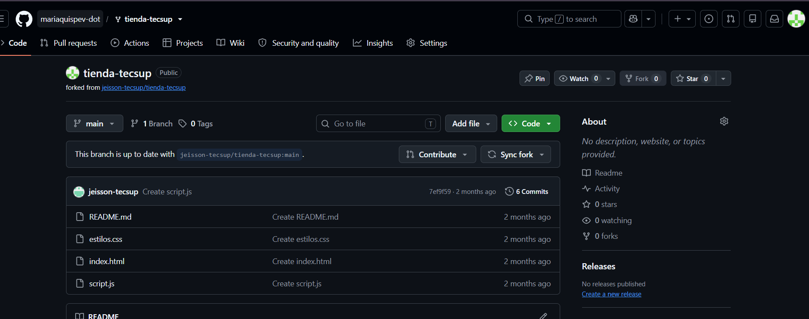

# Guía del Laboratorio 03: Trabajo Colaborativo

Esta guía documenta los pasos necesarios para realizar y colaborar en un proyecto usando Git y GitHub de forma segura.

## Pasos de instalación y uso

1. Clonar el repositorio en tu computadora usando el comando git clone.
2. Abrir la carpeta del proyecto en Visual Studio Code.
3. Sincronizar los cambios con la rama principal.

- *Git* para control de versiones local.
- *GitHub* para la gestión remota del código.

## Tareas completadas

- [x] Configuración inicial del repositorio
- [x] Creación de ramas e integración de cambios
- [ ] Despliegue en producción

## Archivos y comandos principales

| Archivo / Comando | Descripción |
| :--- | :--- |
| README.md | Archivo principal de presentación del proyecto. |
| git status | Comando para verificar el estado de los archivos modificados. |
| docs/GUIA.md | Documentación detallada del flujo de trabajo. |

## Enlaces e imágenes

- Puedes consultar más información oficial en [GitHub Docs](https://github.com/mariaquispev-dot/).

-[Guia del proyecto](docs/GUIA.md)